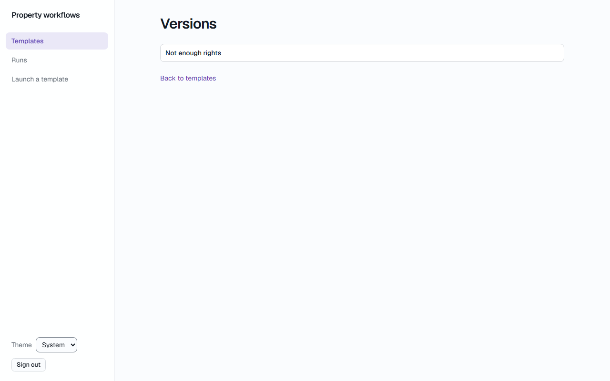
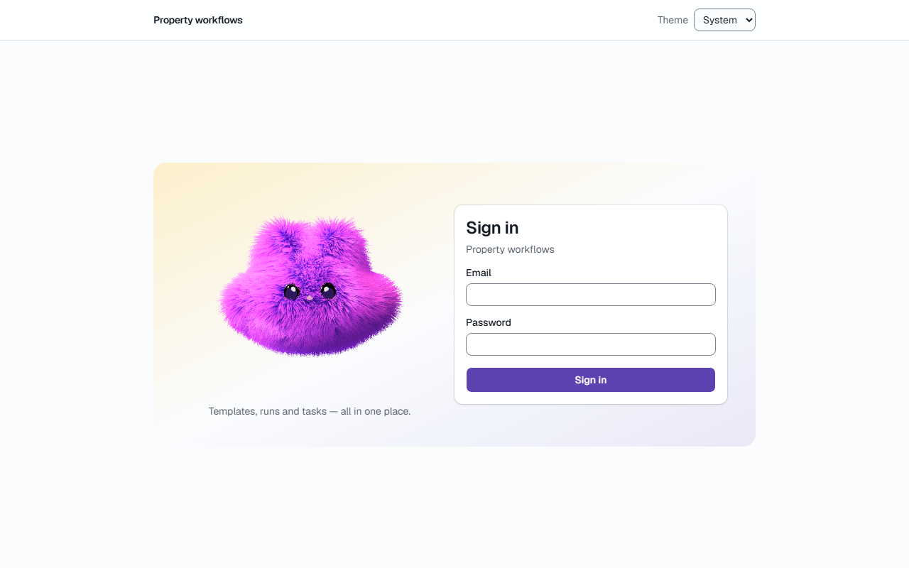
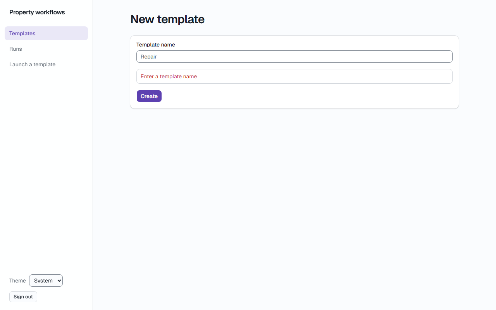
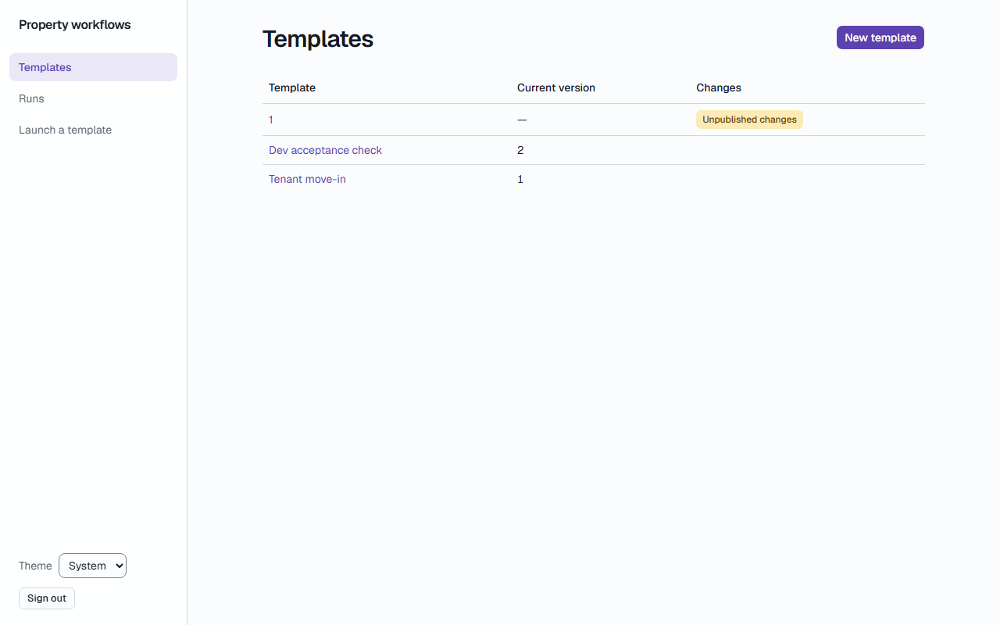

# Звіт UAT — 02.11.2026

- **Застосунок:** https://property-workflows-one.vercel.app (/api/health: коміт `104c72c`)
- **Код тестів:** `task/uat` @ `eafdf7d`
- **Прогін:** 02.11.2026, 12:06 (Київ), Playwright 56.1 с; AC: 3 — PASS 3, FAIL 0, NEEDS-HUMAN 0
- **Рецензент:** `claude-haiku-5-5`; суперечки → `claude-sonnet-5-5`. Разом за розбір: $0.0465 (ціни API; за підпискою — у межах ліміту плану)
- **Прибирання:** синтетичних uat-*@example.test видалено 0, лишилось 0, їхніх рядків, що лишились: 0
- **Відео й траси:** не в git — `test-results/` локально або артефакт CI; трасу відкриває `npx playwright show-trace <trace.zip>`

| AC | Перевірки | Агент | Підсумок | Чому | Playwright | Розбір |
|---|---|---|---|---|---|---|
| AC-EDITOR-07 | пройшли | Haiku: PASS | **PASS** | R6: перевірки, агент і цитати збігаються | 3.9 с | $0.0020, 9.8 с |
| AC-EDITOR-09 | пройшли | Haiku: PASS | **PASS** | R6: перевірки, агент і цитати збігаються | 10.3 с | $0.0019, 6.6 с |
| AC-EDITOR-19 | пройшли | Haiku: NEEDS-HUMAN, Sonnet: PASS | **PASS** | R6: перевірки, агент і цитати збігаються | 13.3 с | $0.0425, 29.4 с |

## AC-EDITOR-07 — PASS

**Тест:** AC-EDITOR-07: manager B opens the list of versions by a direct link — "Not enough rights" and no versions

**Критерій** (requirements/20-edit-a-template-with-version-control.md):

> AC-EDITOR-07: Given manager B signed in and the template "Tenant move-in" with versions 1 and 2. When B opens the list of versions of this template by a direct link. Then B sees the message "Not enough rights" and no versions.

**Кроки:** ✔ Дано: manager B signed in and the template "Tenant move-in" with versions → ✔ Коли: B opens the list of versions of this template by a direct link → ✔ Тоді: B sees the message "Not enough rights" and no versions.

**Агент (claude-haiku-5-5, PASS):** На кадрі frame-then-1.png сторінка має заголовок «Versions», під ним один рядок «Not enough rights» і посилання «Back to templates». Таблиці або списку версій на кадрі немає. Обидві видимі частини «Тоді» підтверджено; «no versions» за правилами не оцінюю.

**Цитати агента, звірені зі сторінкою (aria):**
- «Not enough rights» — є на сторінці
- «Versions» — є на сторінці

**Правило:** R6: перевірки, агент і цитати збігаються

**Відео:** `test-results/artifacts/templates-менеджер-AC-EDIT-143c6-ough-rights-and-no-versions-chromium/video.webm` · **траса:** `test-results/artifacts/templates-менеджер-AC-EDIT-143c6-ough-rights-and-no-versions-chromium/trace.zip` (не в git)

**Рішення PM:** ☐ приймаю · ☐ відхилення від вимог (issue «Відхилення від вимог: AC-EDITOR-07 — …») · @login: ____

## AC-EDITOR-09 — PASS

**Тест:** AC-EDITOR-09: a visitor who is not signed in opens the editor by a direct link — the sign-in page and no content of the template

**Критерій** (requirements/20-edit-a-template-with-version-control.md):

> AC-EDITOR-09: Given a visitor who is not signed in. When the visitor opens the editor of the template "Tenant move-in" by a direct link. Then the visitor sees the sign-in page and no content of the template.

**Кроки:** ✔ Дано: a visitor who is not signed in → ✔ Коли: the visitor opens the editor of the template "Tenant move-in" by a direct link → ✔ Тоді: the visitor sees the sign-in page and no content of the template.

**Агент (claude-haiku-5-5, PASS):** На кадрі frame-then-1.png видно сторінку входу: заголовок «Sign in», поля «Email» і «Password», кнопка «Sign in» і підпис «Property workflows». Кадр чіткий, не обрізаний і не в стані завантаження. Відсутність вмісту шаблону та адреса /login не оцінювалися, бо це частини «Не з кадрів».

**Цитати агента, звірені зі сторінкою (aria):**
- «Sign in» — є на сторінці
- «Email» — є на сторінці
- «Password» — є на сторінці

**Правило:** R6: перевірки, агент і цитати збігаються

**Відео:** `test-results/artifacts/templates-відвідувач-без-в-46178--no-content-of-the-template-chromium/video.webm` · **траса:** `test-results/artifacts/templates-відвідувач-без-в-46178--no-content-of-the-template-chromium/trace.zip` (не в git)

**Рішення PM:** ☐ приймаю · ☐ відхилення від вимог (issue «Відхилення від вимог: AC-EDITOR-09 — …») · @login: ____

## AC-EDITOR-19 — PASS

**Тест:** AC-EDITOR-19: administrator A creates a template with an empty name or only spaces — no template is created and "Enter a template name"

**Критерій** (requirements/20-edit-a-template-with-version-control.md):

> AC-EDITOR-19: Given administrator A. When A creates a new template with the name empty or consisting only of spaces. Then no template is created, and A sees the message "Enter a template name".

**Кроки:** ✔ Дано: administrator A → ✔ Коли: A creates a new template with the name consisting only of spaces → ✔ Тоді: A sees the message "Enter a template name". → ✔ Тоді: no template is created

**Агент (claude-sonnet-5-5, PASS):** На першому кадрі форма «New template» відкрита, під полем «Template name» червоним написано «Enter a template name». У полі сірим видно «Repair», схоже на placeholder. На другому кадрі показано список «Templates» із трьома рядками. Кількість шаблонів до спроби з кадрів не перевіряється.

Haiku сказав NEEDS-HUMAN, тож розбір повторив Sonnet; рішення агента — за Sonnet.

**Цитати агента, звірені зі сторінкою (aria):**
- «Template name» — є на сторінці
- «Enter a template name» — є на сторінці
- «New template» — є на сторінці
- «Template name» — є на сторінці
- «Create» — є на сторінці
- «Templates» — є на сторінці
- «Template» — є на сторінці
- «Current version» — є на сторінці
- «Changes» — є на сторінці
- «Dev acceptance check» — є на сторінці
- «Tenant move-in» — є на сторінці

**Правило:** R6: перевірки, агент і цитати збігаються

**Відео:** `test-results/artifacts/templates-адміністратор-AC-3e693--and-Enter-a-template-name--chromium/video.webm` · **траса:** `test-results/artifacts/templates-адміністратор-AC-3e693--and-Enter-a-template-name--chromium/trace.zip` (не в git)

**Рішення PM:** ☐ приймаю · ☐ відхилення від вимог (issue «Відхилення від вимог: AC-EDITOR-19 — …») · @login: ____

## Як читати підсумок

- **PASS** — автоматичні перевірки пройшли, агент-рецензент погодився з кадром, а кожну його цитату знайдено на сторінці.
- **FAIL** — впала автоматична перевірка. Агент цього не перекриває: невидимі вади (буфер обміну, база) він на кадрі не побачить.
- **NEEDS-HUMAN** — перевірки зелені, але агент не погодився або його цитати немає на сторінці. Часто це слабкий тест або розбіжність між текстом AC і тестом — питання до PM, а не обов'язково вада продукту.

Правила: R1: перевірка впала — FAIL завжди, агент не перекриває; R2: немає вердикту агента або кадру; R3: перевірки пройшли, агент не погоджується — вирішує людина; R4: цитати агента немає на сторінці (aria) — не підтверджено; R5: помилка сторінки або 5xx під час сценарію; R6: перевірки, агент і цитати збігаються.
