# Звіт UAT — 09.11.2026

- **Застосунок:** https://property-workflows-one.vercel.app (/api/health: коміт `3f076f3`)
- **Код тестів:** `task/vendor-uat` @ `eea84db`
- **Прогін:** 09.11.2026, 11:53 (Київ), Playwright 232.7 с; AC: 13 — PASS 13, FAIL 0, NEEDS-HUMAN 0
- **Рецензент:** `claude-haiku-5-5`; суперечки → `claude-sonnet-5-5`. Разом за розбір: $0.0672 (ціни API; за підпискою — у межах ліміту плану)
- **Прибирання:** синтетичних uat-*@example.test видалено 3, лишилось 0, їхніх рядків, що лишились: 0
- **Відео й траси:** не в git — `test-results/` локально або артефакт CI; трасу відкриває `npx playwright show-trace <trace.zip>`

| AC | Перевірки | Агент | Підсумок | Чому | Playwright | Розбір |
|---|---|---|---|---|---|---|
| AC-EDITOR-07 | пройшли | Haiku: PASS | **PASS** | R6: перевірки, агент і цитати збігаються | 5.2 с | $0.0021, 9.8 с |
| AC-EDITOR-09 | пройшли | Haiku: PASS | **PASS** | R6: перевірки, агент і цитати збігаються | 15.5 с | $0.0022, 10.5 с |
| AC-EDITOR-19 | пройшли | Haiku: NEEDS-HUMAN, Sonnet: PASS | **PASS** | R6: перевірки, агент і цитати збігаються | 16.2 с | $0.0420, 26.2 с |
| AC-VENDOR-01 | пройшли | Haiku: PASS | **PASS** | R6: перевірки, агент і цитати збігаються | 13.5 с | $0.0024, 11.7 с |
| AC-VENDOR-02 | пройшли | Haiku: PASS | **PASS** | R6: перевірки, агент і цитати збігаються | 5.6 с | $0.0021, 8.6 с |
| AC-VENDOR-03 | пройшли | Haiku: PASS | **PASS** | R6: перевірки, агент і цитати збігаються | 9.1 с | $0.0020, 8.0 с |
| AC-VENDOR-04 | пройшли | Haiku: PASS | **PASS** | R6: перевірки, агент і цитати збігаються | 5.1 с | $0.0024, 11.0 с |
| AC-VENDOR-05 | пройшли | Haiku: PASS | **PASS** | R6: перевірки, агент і цитати збігаються | 6.3 с | $0.0021, 9.3 с |
| AC-VENDOR-06 | пройшли | Haiku: PASS | **PASS** | R6: перевірки, агент і цитати збігаються | 3.7 с | $0.0019, 7.3 с |
| AC-VENDOR-07 | пройшли | Haiku: PASS | **PASS** | R6: перевірки, агент і цитати збігаються | 5.3 с | $0.0021, 8.5 с |
| AC-VENDOR-08 | пройшли | Haiku: PASS | **PASS** | R6: перевірки, агент і цитати збігаються | 4.4 с | $0.0019, 7.0 с |
| AC-VENDOR-09 | пройшли | Haiku: PASS | **PASS** | R6: перевірки, агент і цитати збігаються | 4.9 с | $0.0023, 10.9 с |
| AC-VENDOR-10 | пройшли | Haiku: PASS | **PASS** | R6: перевірки, агент і цитати збігаються | 2.8 с | $0.0019, 6.7 с |

## AC-EDITOR-07 — PASS

**Тест:** AC-EDITOR-07: manager B opens the list of versions by a direct link — "Not enough rights" and no versions

**Критерій** (requirements/20-edit-a-template-with-version-control.md):

> AC-EDITOR-07: Given manager B signed in and the template "Tenant move-in" with versions 1 and 2. When B opens the list of versions of this template by a direct link. Then B sees the message "Not enough rights" and no versions.

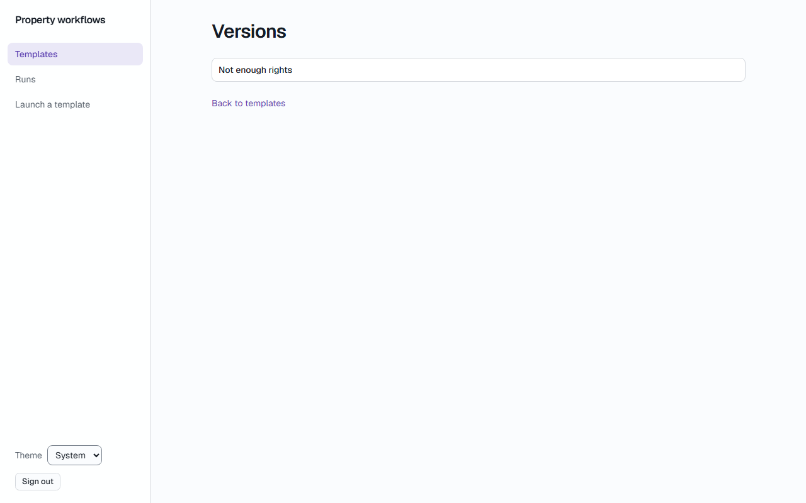

**Кроки:** ✔ Дано: manager B signed in and the template "Tenant move-in" with versions → ✔ Коли: B opens the list of versions of this template by a direct link → ✔ Тоді: B sees the message "Not enough rights" and no versions.

**Агент (claude-haiku-5-5, PASS):** На кадрі frame-then-1.png видно заголовок сторінки «Versions» і рядок повідомлення «Not enough rights» посимвольно збігається з критерієм. Таблиці чи списку версій на сторінці немає; посилання «Back to templates» і меню зліва не суперечать критерію. Частина «no versions» віднесена до автоматичних перевірок і не оцінювалась.

**Цитати агента, звірені зі сторінкою (aria):**
- «Not enough rights» — є на сторінці
- «Versions» — є на сторінці

**Правило:** R6: перевірки, агент і цитати збігаються

**Відео:** `test-results/artifacts/templates-менеджер-AC-EDIT-143c6-ough-rights-and-no-versions-chromium/video.webm` · **траса:** `test-results/artifacts/templates-менеджер-AC-EDIT-143c6-ough-rights-and-no-versions-chromium/trace.zip` (не в git)

**Рішення PM:** ☐ приймаю · ☐ відхилення від вимог (issue «Відхилення від вимог: AC-EDITOR-07 — …») · @login: ____

## AC-EDITOR-09 — PASS

**Тест:** AC-EDITOR-09: a visitor who is not signed in opens the editor by a direct link — the sign-in page and no content of the template

**Критерій** (requirements/20-edit-a-template-with-version-control.md):

> AC-EDITOR-09: Given a visitor who is not signed in. When the visitor opens the editor of the template "Tenant move-in" by a direct link. Then the visitor sees the sign-in page and no content of the template.

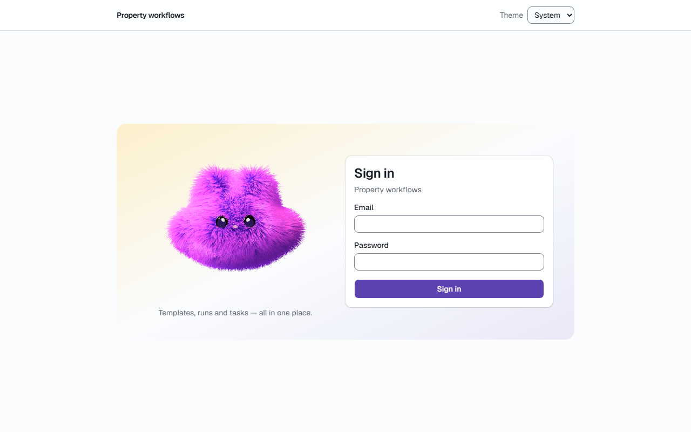

**Кроки:** ✔ Дано: a visitor who is not signed in → ✔ Коли: the visitor opens the editor of the template "Tenant move-in" by a direct link → ✔ Тоді: the visitor sees the sign-in page and no content of the template.

**Агент (claude-haiku-5-5, PASS):** На кадрі видно сторінку входу: заголовок «Sign in», підпис «Property workflows», поля «Email» і «Password» та кнопка «Sign in». Вмісту шаблону «Tenant move-in» на кадрі немає, але ця частина і адресна строка (/login) не з кадрів, тому я їх не оцінював.

**Цитати агента, звірені зі сторінкою (aria):**
- «Sign in» — є на сторінці
- «Email» — є на сторінці
- «Password» — є на сторінці

**Правило:** R6: перевірки, агент і цитати збігаються

**Відео:** `test-results/artifacts/templates-відвідувач-без-в-46178--no-content-of-the-template-chromium/video.webm` · **траса:** `test-results/artifacts/templates-відвідувач-без-в-46178--no-content-of-the-template-chromium/trace.zip` (не в git)

**Рішення PM:** ☐ приймаю · ☐ відхилення від вимог (issue «Відхилення від вимог: AC-EDITOR-09 — …») · @login: ____

## AC-EDITOR-19 — PASS

**Тест:** AC-EDITOR-19: administrator A creates a template with an empty name or only spaces — no template is created and "Enter a template name"

**Критерій** (requirements/20-edit-a-template-with-version-control.md):

> AC-EDITOR-19: Given administrator A. When A creates a new template with the name empty or consisting only of spaces. Then no template is created, and A sees the message "Enter a template name".

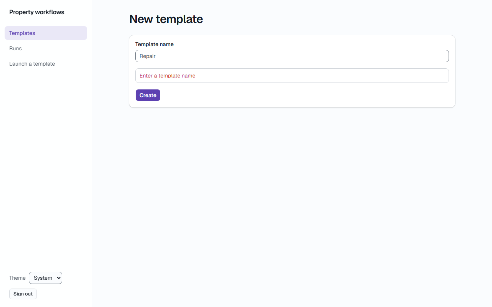
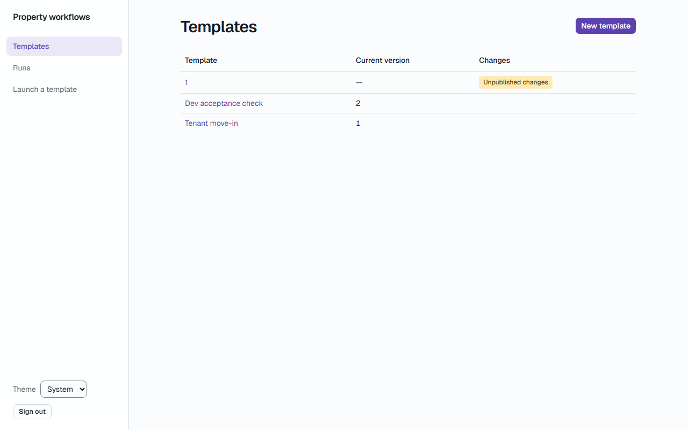

**Кроки:** ✔ Дано: administrator A → ✔ Коли: A creates a new template with the name consisting only of spaces → ✔ Тоді: A sees the message "Enter a template name". → ✔ Тоді: no template is created

**Агент (claude-sonnet-5-5, PASS):** На першому кадрі сторінка «New template» залишається відкритою, під полем «Template name» червоний напис «Enter a template name». На другому кадрі видно таблицю шаблонів (1, Dev acceptance check, Tenant move-in). Кількість шаблонів до спроби з кадрів не оцінювалась.

Haiku сказав NEEDS-HUMAN, тож розбір повторив Sonnet; рішення агента — за Sonnet.

**Цитати агента, звірені зі сторінкою (aria):**
- «Template name» — є на сторінці
- «Enter a template name» — є на сторінці
- «New template» — є на сторінці
- «Template name» — є на сторінці
- «Create» — є на сторінці
- «Templates» — є на сторінці
- «Template» — є на сторінці
- «Current version» — є на сторінці
- «Changes» — є на сторінці
- «Dev acceptance check» — є на сторінці
- «Tenant move-in» — є на сторінці

**Правило:** R6: перевірки, агент і цитати збігаються

**Відео:** `test-results/artifacts/templates-адміністратор-AC-3e693--and-Enter-a-template-name--chromium/video.webm` · **траса:** `test-results/artifacts/templates-адміністратор-AC-3e693--and-Enter-a-template-name--chromium/trace.zip` (не в git)

**Рішення PM:** ☐ приймаю · ☐ відхилення від вимог (issue «Відхилення від вимог: AC-EDITOR-19 — …») · @login: ____

## AC-VENDOR-01 — PASS

**Тест:** AC-VENDOR-01: manager A assigns vendor V to tasks 3 and 4 at launch — tasks 3 and 4 have V, tasks 1, 2 and 5 have A

**Критерій** (requirements/39-assign-a-vendor.md):

> AC-VENDOR-01: Given manager A, vendor V and the template "Tenant move-in" with 5 tasks. When A launches the template for the case "Apartment 12, move-in" and assigns V as the assignee of tasks 3 and 4. Then tasks 3 and 4 have V as the assignee, and tasks 1, 2 and 5 have A.

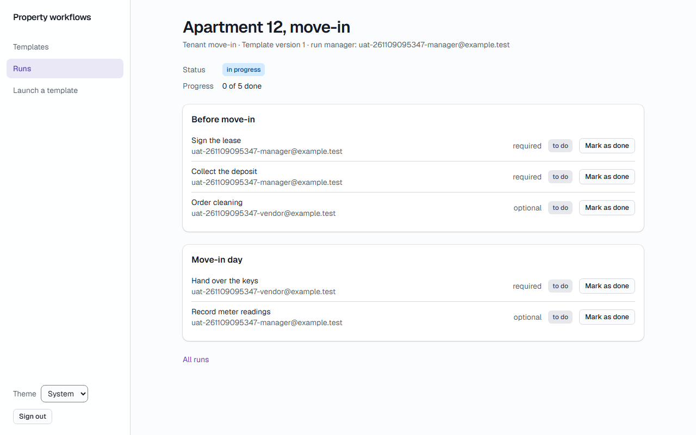

**Кроки:** ✔ Дано: manager A, vendor V and the template "Tenant move-in" with 5 tasks → ✔ Коли: A launches the template for the case "Apartment 12, move-in" and assigns V as the assignee of tasks 3 and 4 → ✔ Тоді: tasks 3 and 4 have V as the assignee, and tasks 1, 2 and 5 have A.

**Агент (claude-haiku-5-5, PASS):** На кадрі frame-then-1.png видно run «Apartment 12, move-in» із 5 завданнями у порядку: Sign the lease, Collect the deposit, Order cleaning, Hand over the keys, Record meter readings. Email vendor-а стоїть біля Order cleaning (завдання 3) і Hand over the keys (завдання 4), а email manager-а — біля завдань 1, 2 і 5, що відповідає критерію.

**Цитати агента, звірені зі сторінкою (aria):**
- «Order cleaning» — є на сторінці
- «uat-261109095347-vendor@example.test» — є на сторінці
- «Hand over the keys» — є на сторінці
- «uat-261109095347-vendor@example.test» — є на сторінці
- «Sign the lease» — є на сторінці
- «uat-261109095347-manager@example.test» — є на сторінці
- «Collect the deposit» — є на сторінці
- «uat-261109095347-manager@example.test» — є на сторінці
- «Record meter readings» — є на сторінці
- «uat-261109095347-manager@example.test» — є на сторінці

**Правило:** R6: перевірки, агент і цитати збігаються

**Відео:** `test-results/artifacts/vendor-менеджер-A-AC-VENDO-f1f66-ve-V-tasks-1-2-and-5-have-A-chromium/video.webm` · **траса:** `test-results/artifacts/vendor-менеджер-A-AC-VENDO-f1f66-ve-V-tasks-1-2-and-5-have-A-chromium/trace.zip` (не в git)

**Рішення PM:** ☐ приймаю · ☐ відхилення від вимог (issue «Відхилення від вимог: AC-VENDOR-01 — …») · @login: ____

## AC-VENDOR-02 — PASS

**Тест:** AC-VENDOR-02: manager A opens the assignee picker — the emails of B, of the administrator and of V, and no names or roles

**Критерій** (requirements/39-assign-a-vendor.md):

> AC-VENDOR-02: Given managers A and B, an administrator and vendor V, and A launching a template. When A opens the assignee picker. Then A sees the emails of B, of the administrator and of V, and no names, roles or other profile data.

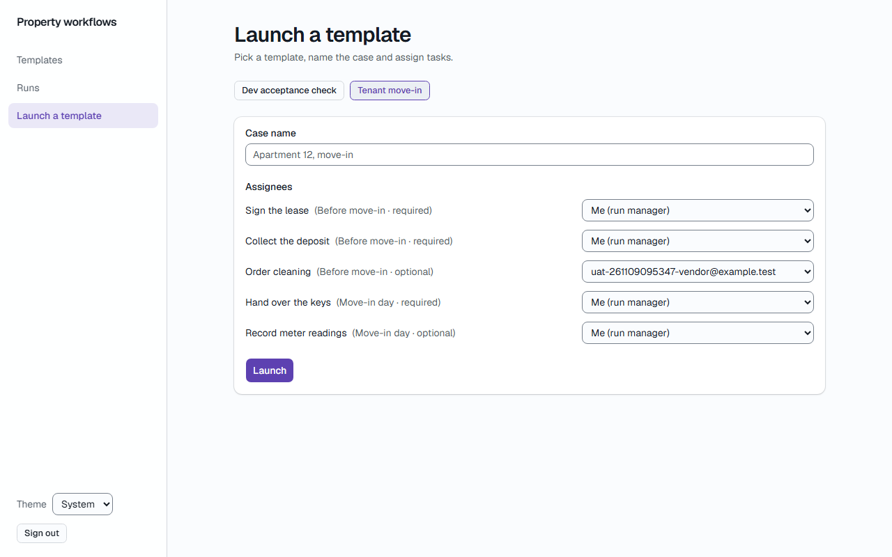

**Кроки:** ✔ Дано: managers A and B, an administrator and vendor V, and A launching a template → ✔ Коли: A opens the assignee picker → ✔ Тоді: A sees the emails of B, of the administrator and of V, and no names, roles or other profile data.

**Агент (claude-haiku-5-5, PASS):** На кадрі сторінка «Launch a template» з рядком «Order cleaning», де в полі вибору виконавця видно «uat-261109095347-vendor@example.test» — це email вендора V, як вимагає видима частина «Тоді». Список варіантів у розкритому виді на кадрі не показаний, тож склад picker (email B і адміністратора, відсутність імен і ролей) не перевірявся з кадрів і позначений як cannot-tell.

**Цитати агента, звірені зі сторінкою (aria):**
- «uat-261109095347-vendor@example.test» — є на сторінці

**Правило:** R6: перевірки, агент і цитати збігаються

**Відео:** `test-results/artifacts/vendor-менеджер-A-AC-VENDO-123e5--of-V-and-no-names-or-roles-chromium/video.webm` · **траса:** `test-results/artifacts/vendor-менеджер-A-AC-VENDO-123e5--of-V-and-no-names-or-roles-chromium/trace.zip` (не в git)

**Рішення PM:** ☐ приймаю · ☐ відхилення від вимог (issue «Відхилення від вимог: AC-VENDOR-02 — …») · @login: ____

## AC-VENDOR-03 — PASS

**Тест:** AC-VENDOR-03: vendor V opens the list of runs — only "Apartment 12, move-in" with its run status and "Your tasks: 0 of 2 done"

**Критерій** (requirements/39-assign-a-vendor.md):

> AC-VENDOR-03: Given vendor V who is the assignee of 2 tasks in the run "Apartment 12, move-in" and of no task in the run "Apartment 14, repair". When V opens the list of runs. Then V sees only the run "Apartment 12, move-in" with its run status and "Your tasks: 0 of 2 done", and does not see "Apartment 14, repair".

**Кроки:** ✔ Дано: vendor V who is the assignee of 2 tasks in the run "Apartment 12, move-in" and of no task in the run "Apartment 14, repair" → ✔ Коли: V opens the list of runs → ✔ Тоді: V sees only the run "Apartment 12, move-in" with its run status and "Your tasks: 0 of 2 done", and does not see "Apartment 14, repair".

**Агент (claude-haiku-5-5, PASS):** На кадрі сторінки «Runs» видно один рядок з «Apartment 12, move-in», статусом «in progress» і написом «Your tasks: 0 of 2 done». Рядка «Apartment 14, repair» на кадрі немає, що узгоджується з критерієм (ця частина з кадрів не оцінюється окремо).

**Цитати агента, звірені зі сторінкою (aria):**
- «Apartment 12, move-in» — є на сторінці
- «in progress» — є на сторінці
- «Your tasks: 0 of 2 done» — є на сторінці

**Правило:** R6: перевірки, агент і цитати збігаються

**Відео:** `test-results/artifacts/vendor-вендор-V-AC-VENDOR--3c3c2-and-Your-tasks-0-of-2-done--chromium/video.webm` · **траса:** `test-results/artifacts/vendor-вендор-V-AC-VENDOR--3c3c2-and-Your-tasks-0-of-2-done--chromium/trace.zip` (не в git)

**Рішення PM:** ☐ приймаю · ☐ відхилення від вимог (issue «Відхилення від вимог: AC-VENDOR-03 — …») · @login: ____

## AC-VENDOR-04 — PASS

**Тест:** AC-VENDOR-04: vendor V opens the run "Apartment 12, move-in" — exactly tasks 3 and 4, no other tasks, emails or progress of the run

**Критерій** (requirements/39-assign-a-vendor.md):

> AC-VENDOR-04: Given vendor V who is the assignee of tasks 3 and 4 in the run "Apartment 12, move-in" (5 tasks). When V opens this run. Then V sees exactly tasks 3 and 4, each with its name, its section, the mark "required" or "optional" and its status, and does not see tasks 1, 2 and 5, the emails of other users or the progress of the whole run.

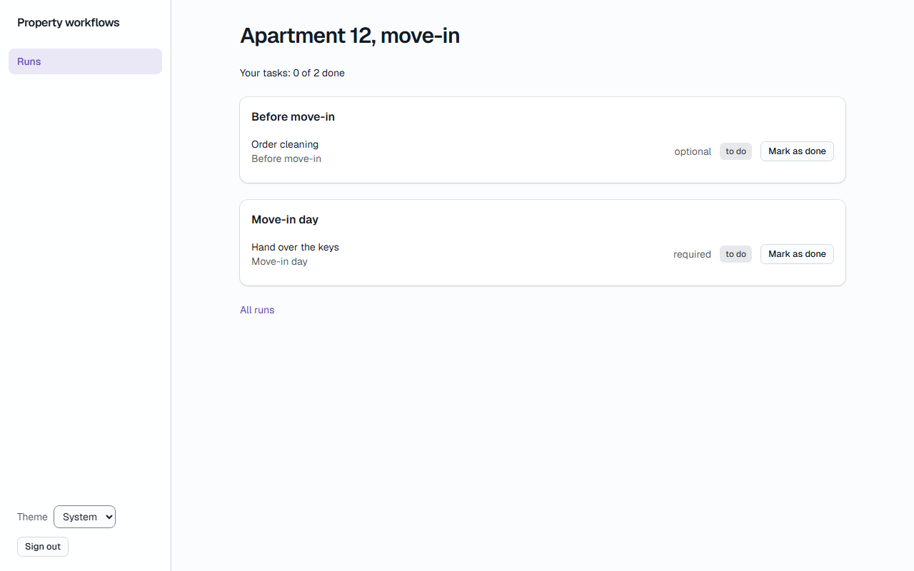

**Кроки:** ✔ Дано: vendor V who is the assignee of tasks 3 and 4 in the run "Apartment 12, move-in" (5 tasks) → ✔ Коли: V opens this run → ✔ Тоді: V sees exactly tasks 3 and 4, each with its name, its section, the mark "required" or "optional" and its status, and does not see tasks 1, 2 and 5, the emails of other users or the progress of the whole run.

**Агент (claude-haiku-5-5, PASS):** На кадрі frame-then-1.png видно два завдання V: "Order cleaning" у розділі "Before move-in" (optional, to do) і "Hand over the keys" у розділі "Move-in day" (required, to do). Рядок "Your tasks: 0 of 2 done" стосується лише завдань V, а не всього run із 5 завдань, тож суперечності з критерієм немає. Відсутність інших завдань, email і загального прогресу перевіряють автоматичні перевірки, тому тут їх не оцінювано.

**Цитати агента, звірені зі сторінкою (aria):**
- «Order cleaning» — є на сторінці
- «Before move-in» — є на сторінці
- «optional» — є на сторінці
- «to do» — є на сторінці
- «Hand over the keys» — є на сторінці
- «Move-in day» — є на сторінці
- «required» — є на сторінці
- «to do» — є на сторінці

**Правило:** R6: перевірки, агент і цитати збігаються

**Відео:** `test-results/artifacts/vendor-вендор-V-AC-VENDOR--ad38e-ails-or-progress-of-the-run-chromium/video.webm` · **траса:** `test-results/artifacts/vendor-вендор-V-AC-VENDOR--ad38e-ails-or-progress-of-the-run-chromium/trace.zip` (не в git)

**Рішення PM:** ☐ приймаю · ☐ відхилення від вимог (issue «Відхилення від вимог: AC-VENDOR-04 — …») · @login: ____

## AC-VENDOR-05 — PASS

**Тест:** AC-VENDOR-05: vendor V marks task 3 as done — task 3 has status "done", and V sees "Your tasks: 1 of 2 done"

**Критерій** (requirements/39-assign-a-vendor.md):

> AC-VENDOR-05: Given vendor V who is the assignee of task 3 with status "to do", which is not the last required task of the run "Apartment 12, move-in". When V marks task 3 as done. Then task 3 has status "done", and V sees "Your tasks: 1 of 2 done".

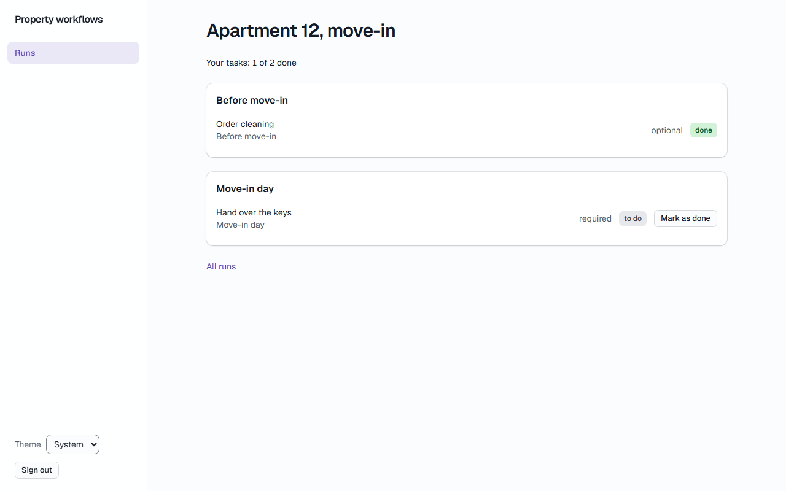

**Кроки:** ✔ Дано: vendor V who is the assignee of task 3 with status "to do", which is not the last required task of the run "Apartment 12, move-in" → ✔ Коли: V marks task 3 as done → ✔ Тоді: task 3 has status "done", and V sees "Your tasks: 1 of 2 done".

**Агент (claude-haiku-5-5, PASS):** На кадрі видно картку «Order cleaning» у блоці «Before move-in» зі значком «done», а над картками написано «Your tasks: 1 of 2 done». Обидві видимі частини «Тоді» збігаються дослівно з критерієм. Кадр читабельний і повний; на кадрі немає ідентифікатора задачі, тому відповідність «Order cleaning» задачі 3 перевіряється через перелік видимих частин в ac.md.

**Цитати агента, звірені зі сторінкою (aria):**
- «Order cleaning» — є на сторінці
- «done» — є на сторінці
- «Your tasks: 1 of 2 done» — є на сторінці

**Правило:** R6: перевірки, агент і цитати збігаються

**Відео:** `test-results/artifacts/vendor-вендор-V-AC-VENDOR--00355-ees-Your-tasks-1-of-2-done--chromium/video.webm` · **траса:** `test-results/artifacts/vendor-вендор-V-AC-VENDOR--00355-ees-Your-tasks-1-of-2-done--chromium/trace.zip` (не в git)

**Рішення PM:** ☐ приймаю · ☐ відхилення від вимог (issue «Відхилення від вимог: AC-VENDOR-05 — …») · @login: ____

## AC-VENDOR-06 — PASS

**Тест:** AC-VENDOR-06: vendor V opens the run "Apartment 14, repair" by a direct link — "Run not found" and none of its tasks

**Критерій** (requirements/39-assign-a-vendor.md):

> AC-VENDOR-06: Given the run "Apartment 14, repair" in which vendor V has no task. When V opens the page of this run by a direct link. Then V sees the message "Run not found" and none of the tasks of the run.

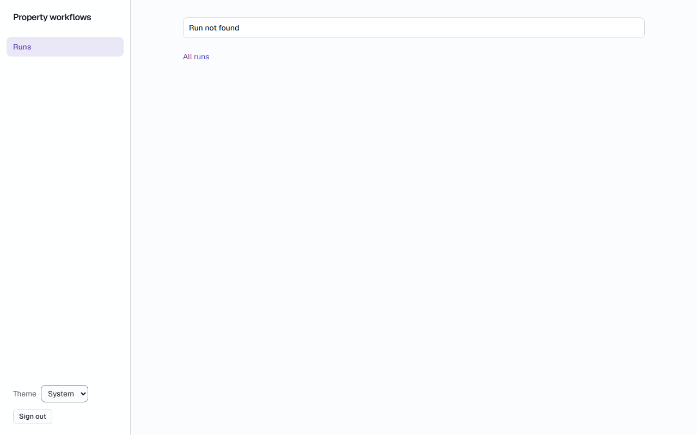

**Кроки:** ✔ Дано: the run "Apartment 14, repair" in which vendor V has no task → ✔ Коли: V opens the page of this run by a direct link → ✔ Тоді: V sees the message "Run not found" and none of the tasks of the run.

**Агент (claude-haiku-5-5, PASS):** На кадрі видно сторінку з написом «Run not found» у верхній частині основної області, а також посилання «All runs» і бічну навігацію «Runs». Жодних задач або назви «Apartment 14, repair» на кадрі немає. Видима частина «Тоді» підтверджена дослівно; решта частин не з кадрів.

**Цитати агента, звірені зі сторінкою (aria):**
- «Run not found» — є на сторінці

**Правило:** R6: перевірки, агент і цитати збігаються

**Відео:** `test-results/artifacts/vendor-вендор-V-AC-VENDOR--d185b-found-and-none-of-its-tasks-chromium/video.webm` · **траса:** `test-results/artifacts/vendor-вендор-V-AC-VENDOR--d185b-found-and-none-of-its-tasks-chromium/trace.zip` (не в git)

**Рішення PM:** ☐ приймаю · ☐ відхилення від вимог (issue «Відхилення від вимог: AC-VENDOR-06 — …») · @login: ____

## AC-VENDOR-07 — PASS

**Тест:** AC-VENDOR-07: vendor V marks task 1 of manager A directly, bypassing the pages — task 1 stays "to do"

**Критерій** (requirements/39-assign-a-vendor.md):

> AC-VENDOR-07: Given the run "Apartment 12, move-in" in which task 1 is assigned to manager A and tasks 3 and 4 to vendor V. When V tries to mark task 1 as done directly, bypassing the pages of the application. Then task 1 stays "to do".

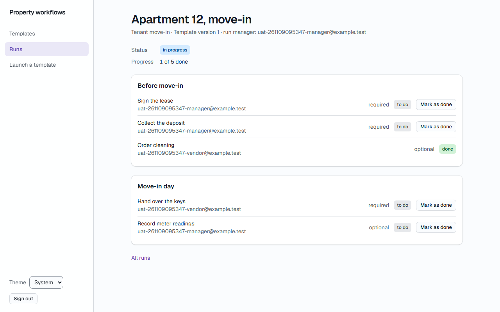

**Кроки:** ✔ Дано: the run "Apartment 12, move-in" in which task 1 is assigned to manager A and tasks 3 and 4 to vendor V → ✔ Коли: V tries to mark task 1 as done directly, bypassing the pages of the application → ✔ Тоді: task 1 stays "to do".

**Агент (claude-haiku-5-5, PASS):** На кадрі видно сторінку «Apartment 12, move-in» з рядком «Sign the lease» (required), статус «to do», виконавець uat-261109095347-manager@example.test, тобто manager A. Частина «the direct request of V was refused» не з кадрів, тому не оцінювалась.

**Цитати агента, звірені зі сторінкою (aria):**
- «Sign the lease» — є на сторінці
- «to do» — є на сторінці

**Правило:** R6: перевірки, агент і цитати збігаються

**Відео:** `test-results/artifacts/vendor-менеджер-A-після-за-92b23-pages-—-task-1-stays-to-do--chromium/video.webm` · **траса:** `test-results/artifacts/vendor-менеджер-A-після-за-92b23-pages-—-task-1-stays-to-do--chromium/trace.zip` (не в git)

**Рішення PM:** ☐ приймаю · ☐ відхилення від вимог (issue «Відхилення від вимог: AC-VENDOR-07 — …») · @login: ____

## AC-VENDOR-08 — PASS

**Тест:** AC-VENDOR-08: vendor V opens the list of templates by a direct link — "Not enough rights" and no template

**Критерій** (requirements/39-assign-a-vendor.md):

> AC-VENDOR-08: Given vendor V signed in. When V opens the list of templates by a direct link. Then V sees the message "Not enough rights" and no template.

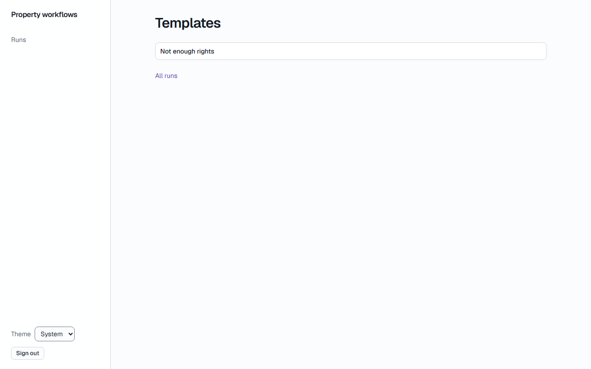

**Кроки:** ✔ Дано: vendor V signed in → ✔ Коли: V opens the list of templates by a direct link → ✔ Тоді: V sees the message "Not enough rights" and no template.

**Агент (claude-haiku-5-5, PASS):** На кадрі сторінки «Templates» у блоці під заголовком видно текст «Not enough rights» дослівно, без зайвих знаків. Таблиці шаблонів на кадрі немає, але за правилами це частина «Не з кадрів», тому я її не оцінюю.

**Цитати агента, звірені зі сторінкою (aria):**
- «Not enough rights» — є на сторінці

**Правило:** R6: перевірки, агент і цитати збігаються

**Відео:** `test-results/artifacts/vendor-вендор-V-AC-VENDOR--d28db-ough-rights-and-no-template-chromium/video.webm` · **траса:** `test-results/artifacts/vendor-вендор-V-AC-VENDOR--d28db-ough-rights-and-no-template-chromium/trace.zip` (не в git)

**Рішення PM:** ☐ приймаю · ☐ відхилення від вимог (issue «Відхилення від вимог: AC-VENDOR-08 — …») · @login: ____

## AC-VENDOR-09 — PASS

**Тест:** AC-VENDOR-09: vendor V launches the template directly, bypassing the pages — no run is created and the list of runs does not change

**Критерій** (requirements/39-assign-a-vendor.md):

> AC-VENDOR-09: Given vendor V signed in and the template "Tenant move-in" with current version 1. When V tries to launch this template directly, bypassing the pages of the application. Then no run is created, and the list of runs does not change.

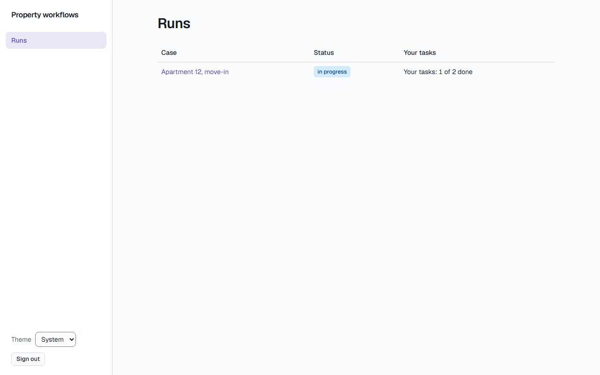

**Кроки:** ✔ Дано: vendor V signed in and the template "Tenant move-in" with current version 1 → ✔ Коли: V tries to launch this template directly, bypassing the pages of the application → ✔ Тоді: no run is created, and the list of runs does not change.

**Агент (claude-haiku-5-5, PASS):** На кадрі frame-then-1.png (сторінка «Runs») видно список з одним рядком: «Apartment 12, move-in», статус «in progress», «Your tasks: 1 of 2 done». Кадр один, тому порівняти список із станом до запуску за ним не можна; видима частина «Тоді» підтверджується, а дві інші частини з розділу «Не з кадрів» не оцінюю.

**Цитати агента, звірені зі сторінкою (aria):**
- «Apartment 12, move-in» — є на сторінці

**Правило:** R6: перевірки, агент і цитати збігаються

**Відео:** `test-results/artifacts/vendor-вендор-V-AC-VENDOR--7068c-ist-of-runs-does-not-change-chromium/video.webm` · **траса:** `test-results/artifacts/vendor-вендор-V-AC-VENDOR--7068c-ist-of-runs-does-not-change-chromium/trace.zip` (не в git)

**Рішення PM:** ☐ приймаю · ☐ відхилення від вимог (issue «Відхилення від вимог: AC-VENDOR-09 — …») · @login: ____

## AC-VENDOR-10 — PASS

**Тест:** AC-VENDOR-10: vendor V with no task opens the list of runs — "No tasks assigned to you yet." and no empty table

**Критерій** (requirements/39-assign-a-vendor.md):

> AC-VENDOR-10: Given vendor V to whom no task is assigned. When V opens the list of runs. Then V sees the message "No tasks assigned to you yet." and no empty table.

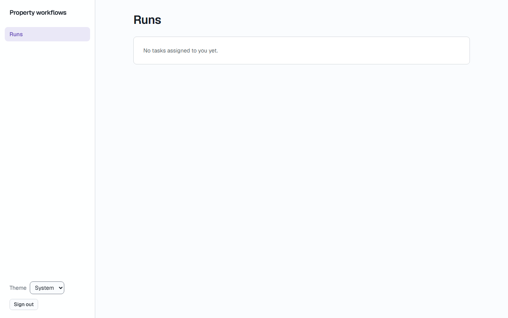

**Кроки:** ✔ Дано: vendor V to whom no task is assigned → ✔ Коли: V opens the list of runs → ✔ Тоді: V sees the message "No tasks assigned to you yet." and no empty table.

**Агент (claude-haiku-5-5, PASS):** На кадрі сторінки «Runs» у білій картці видно текст «No tasks assigned to you yet.», він збігається з критерієм посимвольно. Таблиці на кадрі немає, але за правилами це не оцінюється з кадрів.

**Цитати агента, звірені зі сторінкою (aria):**
- «No tasks assigned to you yet.» — є на сторінці

**Правило:** R6: перевірки, агент і цитати збігаються

**Відео:** `test-results/artifacts/vendor-вендор-без-задач-AC-c22f2--you-yet-and-no-empty-table-chromium/video.webm` · **траса:** `test-results/artifacts/vendor-вендор-без-задач-AC-c22f2--you-yet-and-no-empty-table-chromium/trace.zip` (не в git)

**Рішення PM:** ☐ приймаю · ☐ відхилення від вимог (issue «Відхилення від вимог: AC-VENDOR-10 — …») · @login: ____

## Як читати підсумок

- **PASS** — автоматичні перевірки пройшли, агент-рецензент погодився з кадром, а кожну його цитату знайдено на сторінці.
- **FAIL** — впала автоматична перевірка. Агент цього не перекриває: невидимі вади (буфер обміну, база) він на кадрі не побачить.
- **NEEDS-HUMAN** — перевірки зелені, але агент не погодився або його цитати немає на сторінці. Часто це слабкий тест або розбіжність між текстом AC і тестом — питання до PM, а не обов'язково вада продукту.

Правила: R1: перевірка впала — FAIL завжди, агент не перекриває; R2: немає вердикту агента або кадру; R3: перевірки пройшли, агент не погоджується — вирішує людина; R4: цитати агента немає на сторінці (aria) — не підтверджено; R5: помилка сторінки або 5xx під час сценарію; R6: перевірки, агент і цитати збігаються.
