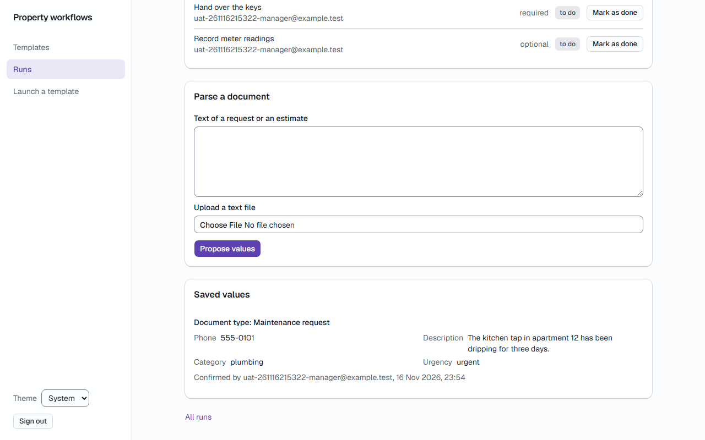
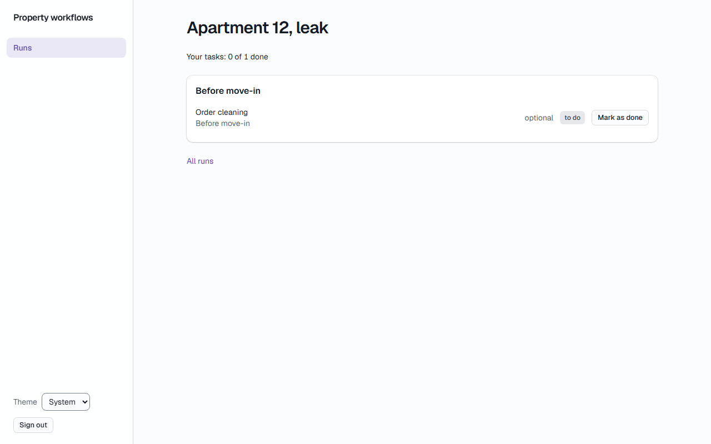

# Звіт UAT — 16.11.2026

- **Застосунок:** https://property-workflows-one.vercel.app (/api/health: коміт `2378758`)
- **Код тестів:** `main` @ `2378758` + незакомічені зміни
- **Прогін:** 16.11.2026, 23:53 (Київ), Playwright 101.8 с; AC: 2 — PASS 1, FAIL 0, NEEDS-HUMAN 1
- **Рецензент:** `claude-haiku-5-5`; суперечки → `claude-sonnet-5-5`. Разом за розбір: $0.0709 (ціни API; за підпискою — у межах ліміту плану)
- **Прибирання:** синтетичних uat-*@example.test видалено 4, лишилось 0, їхніх рядків, що лишились: 0
- **Відео й траси:** не в git — `test-results/` локально або артефакт CI; трасу відкриває `npx playwright show-trace <trace.zip>`

| AC | Перевірки | Агент | Підсумок | Чому | Playwright | Розбір |
|---|---|---|---|---|---|---|
| AC-DOCAI-04 | пройшли | Haiku: PASS, Sonnet: PASS | **NEEDS-HUMAN** | R4: цитати агента немає на сторінці (aria) — не підтверджено | 21.5 с | $0.0353, 19.3 с |
| AC-DOCAI-14 | пройшли | Haiku: NEEDS-HUMAN, Sonnet: PASS | **PASS** | R6: перевірки, агент і цитати збігаються | 2.4 с | $0.0356, 24.0 с |

## AC-DOCAI-04 — NEEDS-HUMAN

**Тест:** AC-DOCAI-04: run manager A changes Urgency to "urgent" and chooses "Save values" — one saved record with A's email and the time

**Критерій** (requirements/59-parse-a-document-and-confirm-values.md):

> AC-DOCAI-04: Given run manager A with Document type "Maintenance request", Phone "555-0101", Category "plumbing" and Urgency "not urgent" proposed in the block. When A changes Urgency to "urgent" and chooses "Save values". Then the page of the run shows one saved record with Document type "Maintenance request", Phone "555-0101", Category "plumbing" and Urgency "urgent", the email of A and the date and time of the confirmation.

**Кроки:** ✔ Дано: run manager A with the values of a request proposed in the block on the page of the run "Apartment 12, leak" → ✔ Коли: A changes Urgency to "urgent" and chooses "Save values" → ✔ Тоді: the page of the run shows one saved record with Document type "Maintenance request", Phone "555-0101", Category "plumbing" and Urgency "urgent", the email of A and the date and time of the confirmation.

**Агент (claude-sonnet-5-5, PASS):** На кадрі в блоці «Saved values» один запис: Document type: Maintenance request, Phone 555-0101, Category plumbing, Urgency urgent. Рядок «Confirmed by uat-261116215322-manager@example.test, 16 Nov 2026, 23:54» показує email і дату з часом. Походження значень від AI з кадру не оцінювалося.

Haiku сказав PASS, тож розбір повторив Sonnet; рішення агента — за Sonnet.

**Цитати агента, звірені зі сторінкою (aria):**
- «Saved values» — є на сторінці
- «Document type: Maintenance request» — є на сторінці
- «Phone 555-0101» — НЕМАЄ на сторінці
- «Category plumbing» — НЕМАЄ на сторінці
- «Urgency urgent» — НЕМАЄ на сторінці
- «Confirmed by uat-261116215322-manager@example.test, 16 Nov 2026, 23:54» — є на сторінці

**Правило:** R4: цитати агента немає на сторінці (aria) — не підтверджено

**Відео:** `test-results/artifacts/doc-parsing-менеджер-запус-c87f1-with-A-s-email-and-the-time-chromium/video.webm` · **траса:** `test-results/artifacts/doc-parsing-менеджер-запус-c87f1-with-A-s-email-and-the-time-chromium/trace.zip` (не в git)

**Рішення PM:** ☐ приймаю · ☐ відхилення від вимог (issue «Відхилення від вимог: AC-DOCAI-04 — …») · @login: ____

## AC-DOCAI-14 — PASS

**Тест:** AC-DOCAI-14: vendor V opens the page of the run — no block "Parse a document"

**Критерій** (requirements/59-parse-a-document-and-confirm-values.md):

> AC-DOCAI-14: Given vendor V who is the assignee of tasks 3 and 4 in the run "Apartment 12, move-in". When V opens the page of this run. Then V does not see the block "Parse a document".

**Кроки:** ✔ Дано: vendor V who is the assignee of a task in the run "Apartment 12, leak" → ✔ Коли: V opens the page of this run → ✔ Тоді: V does not see the block "Parse a document".

**Агент (claude-sonnet-5-5, PASS):** На кадрі видно сторінку запуску із заголовком «Apartment 12, leak». У ній є власне завдання виконавця «Order cleaning» зі статусом «to do». Блоку «Parse a document» на кадрі немає, але цю частину я за правилами не оцінював.

Haiku сказав NEEDS-HUMAN, тож розбір повторив Sonnet; рішення агента — за Sonnet.

**Агент бачить вади:**
- Текст критерію згадує запуск "Apartment 12, move-in" і завдання 3 та 4, а кадр і journey.md стосуються запуску "Apartment 12, leak" з одним завданням. Це розбіжність між критерієм і сценарієм, але видима частина «Тоді» у ac.md сформульована саме для "leak".

**Цитати агента, звірені зі сторінкою (aria):**
- «Apartment 12, leak» — є на сторінці
- «Order cleaning» — є на сторінці

**Правило:** R6: перевірки, агент і цитати збігаються

**Відео:** `test-results/artifacts/doc-parsing-вендор-V-AC-DO-fa629--no-block-Parse-a-document--chromium/video.webm` · **траса:** `test-results/artifacts/doc-parsing-вендор-V-AC-DO-fa629--no-block-Parse-a-document--chromium/trace.zip` (не в git)

**Рішення PM:** ☐ приймаю · ☐ відхилення від вимог (issue «Відхилення від вимог: AC-DOCAI-14 — …») · @login: ____

## Як читати підсумок

- **PASS** — автоматичні перевірки пройшли, агент-рецензент погодився з кадром, а кожну його цитату знайдено на сторінці.
- **FAIL** — впала автоматична перевірка. Агент цього не перекриває: невидимі вади (буфер обміну, база) він на кадрі не побачить.
- **NEEDS-HUMAN** — перевірки зелені, але агент не погодився або його цитати немає на сторінці. Часто це слабкий тест або розбіжність між текстом AC і тестом — питання до PM, а не обов'язково вада продукту.

Правила: R1: перевірка впала — FAIL завжди, агент не перекриває; R2: немає вердикту агента або кадру; R3: перевірки пройшли, агент не погоджується — вирішує людина; R4: цитати агента немає на сторінці (aria) — не підтверджено; R5: помилка сторінки або 5xx під час сценарію; R6: перевірки, агент і цитати збігаються.
